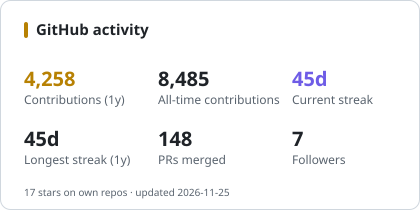
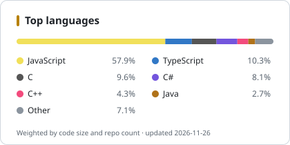

  

  <h1>Hi, I'm Rye Nguyen 👋</h1>

  
<b>Staff Software Engineer</b> · TypeScript, React &amp; React Native, Micro Frontends, Node.js, Go, Kubernetes

  

    
    
    
    
  

---

### 👨‍💻 About me

10+ years building web and mobile products at scale, in ride-hailing, food delivery and stock trading, for up to 10 million users. I like turning complex problems into simple, fast, intuitive interfaces.

- 🔭 Building enterprise React apps and micro frontends (Module Federation)
- 🚢 I own what I ship, end to end: Kubernetes + Helm deploys, CI/CD, Prometheus/Grafana/Loki dashboards and alerts, Sentry for errors and Web Vitals
- ⚡ Focused on performance and developer productivity
- 🌱 Always learning system design and optimization
- 💬 Ask me about React, TypeScript and software architecture
- ⌨️ Lives in Neovim

> _Great things take time. For the greatest, it takes your heart and mind._

### 🛠️ Tech stack

  <b>Frontend &amp; mobile</b>  
  
   React Native · Expo · Micro Frontends · TanStack Query · Zustand

  <b>Backend &amp; data</b>  
  

  <b>Infra &amp; observability</b>  
  
   Helm · Loki · self-hosted CI runners · Neovim

### 📊 GitHub stats

  <picture>
    <source media="(prefers-color-scheme: dark)" srcset="assets/cards/stats-dark.svg" />
    
  </picture>
  <picture>
    <source media="(prefers-color-scheme: dark)" srcset="assets/cards/languages-dark.svg" />
    
  </picture>

  

